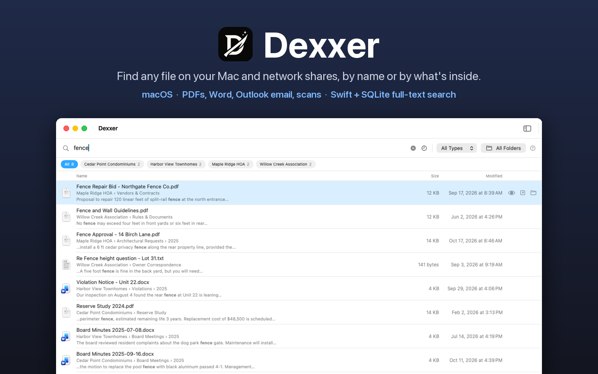

# 🔍 Dexxer



**Fast file search for macOS that reads what's inside your files, including on network shares**

> Made this because I can't find shit in macOS. Finder's search is slow and useless. This actually works.

Dexxer indexes the folders you choose (local or on SMB shares) and searches them instantly: file names, folder names, and the text inside PDFs, Word documents, Outlook emails, and scanned images. Everything stays on your Mac.


## ✨ Features

### Search
- ⚡ **Instant results** from a SQLite FTS5 full-text index, ranked by best match
- 🔤 **Partial words and text inside names**: `budg` finds "Budget", `2023` finds `Budget2023.pdf`
- ✂️ **Snippets** show where a match is inside a file, with your words highlighted
- 🏘️ **Folder chips** narrow results to one indexed folder in a click
- 🎛️ **Search syntax** for filters: `type:pdf size:>10MB modified:30d path:Legal "exact phrase"`
- ⌨️ **Quick search** over any app with ⌥Space, like Spotlight (configurable or off)

### What it reads
- 📄 **PDFs**: the text layer of every page, plus OCR of scanned pages
- 🖼️ **Images**: text recognized with Apple's Vision framework
- 📝 **Word** (`.doc`, `.docx`), **RTF**, **HTML**, and plain text
- ✉️ **Outlook `.msg` emails**: subject, people, body, and attachment names. macOS can't open these on its own, so Dexxer also previews them and lets you open their attachments.

### Network shares and indexing
- 🌐 **Works with SMB shares**, shows which are offline, and never tries to mount them on its own
- 🔁 **Incremental re-indexing**: only new and changed files are read, and extracted text is kept
- 🕒 **Stays current**: optionally re-indexes folders that are more than 12 hours old, including when a share reconnects
- 👁️ **Quick Look previews** and drag-and-drop of results into other apps

## 📥 Download

Get the latest DMG from [Releases](https://github.com/mattgrilli/Dexxer/releases). It runs on Apple Silicon and Intel Macs with macOS 15.5 or later.

The app isn't notarized yet, so the first launch needs one extra step: open the DMG and drag Dexxer to Applications. Open it once and dismiss the "could not verify" warning, then go to **System Settings → Privacy & Security**, scroll down and click **Open Anyway**. (Or in Terminal: `xattr -dr com.apple.quarantine /Applications/Dexxer.app`)

Dexxer lives in the menu bar. Add folders from its window, or drag them onto the sidebar.

## 🔎 Search syntax

| Filter | Example | Matches |
|---|---|---|
| Words | `fence repair` | Files with words starting "fence" and "repair" in the name, folder, or text |
| Phrase | `"annual meeting"` | The exact phrase |
| Type | `type:pdf`, `ext:docx` | File extension (repeat for either: `type:jpg type:png`) |
| Size | `size:>10MB`, `size:<1GB`, `size:5MB-50MB` | File size |
| Date | `modified:today`, `modified:7d`, `modified:thismonth`, `modified:>2024-01-01` | Last modified |
| Folder | `path:Legal`, `folder:2025` | Text anywhere in the folder path |

## 🛠️ Building from source

Requires Xcode 26 or later.

```sh
scripts/dev.sh build   # build (Debug)
scripts/dev.sh run     # build and launch
scripts/dev.sh test    # unit tests
```

`scripts/dev.sh` uses the full Xcode toolchain even if `xcode-select` points at the Command Line Tools, so you can work from VS Code or any editor. Open the project in Xcode if you prefer.

The README hero is generated from fictional demo data: run a Debug build with `-DexxerDemo YES` to capture the window, then `python3 scripts/make_hero.py`.

## 🔒 Privacy

No accounts, no network calls, no telemetry. The index is a SQLite database inside the app's sandbox container, and Dexxer only reads the folders you add.

## License

MIT, see [LICENSE](LICENSE).
